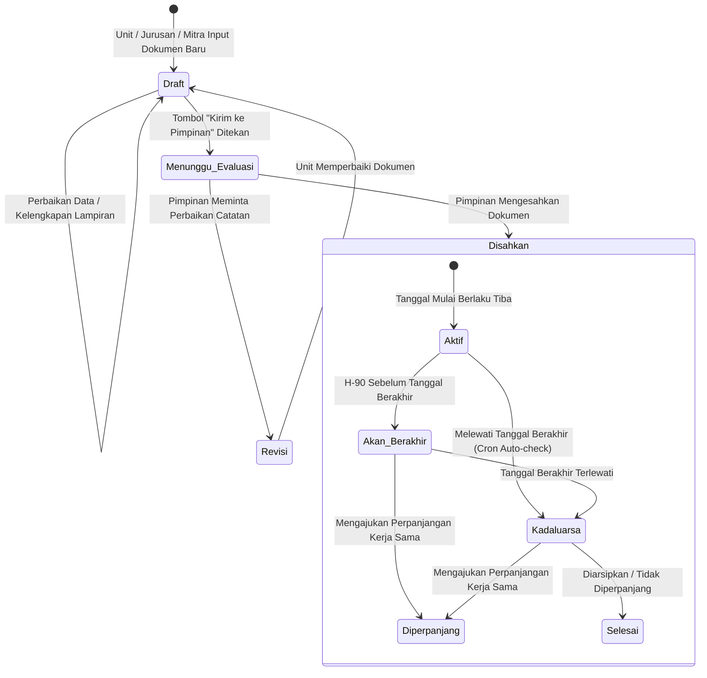
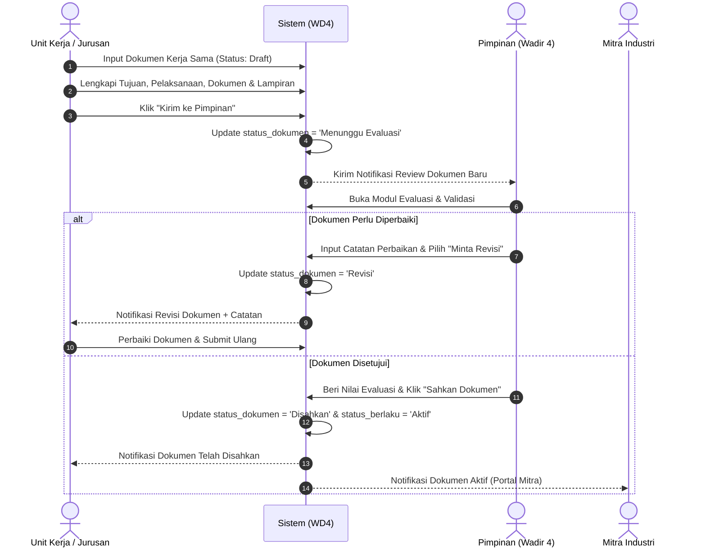
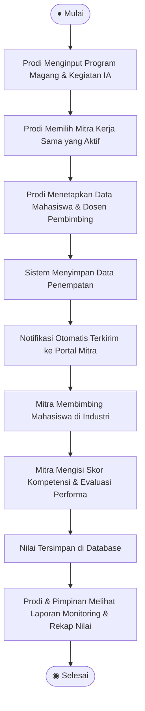
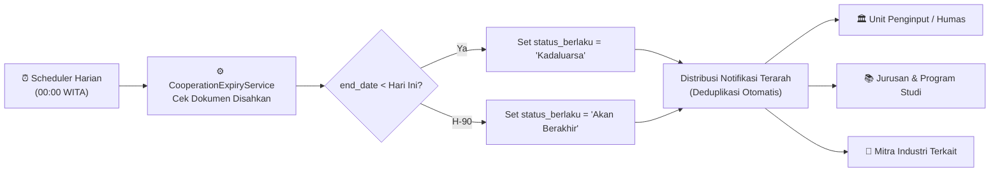

# 🤝 Sistem Informasi Kerja Sama Kampus–DUDIKA (WD4)
### *Smart Collaboration Lifecycle Management System*
**Politeknik Negeri Manado (POLIMDO)**

---

[](https://laravel.com)
[](https://php.net)
[](https://mysql.com)
[](https://alpinejs.dev)
[](https://turbo.hotwired.dev)
[](LICENSE)

---

## 📑 Daftar Isi

- [Tentang Sistem](#-tentang-sistem)
- [Fitur Utama & 10 Subsistem](#-fitur-utama--10-subsistem)
- [Ruang Lingkup Role & Matriks Hak Akses](#-ruang-lingkup-role--matriks-hak-akses)
- [Alur Proses Bisnis & Lifecycle Dokumen](#-alur-proses-bisnis--lifecycle-dokumen)
  - [1. Siklus Hidup Dokumen Kerja Sama](#1-siklus-hidup-dokumen-kerja-sama-state-transition)
  - [2. Alur Pengajuan, Review & Validasi Pimpinan](#2-alur-pengajuan-review--validasi-pimpinan)
  - [3. Alur Monitoring Mahasiswa Magang & Penilaian Mitra](#3-alur-monitoring-mahasiswa-magang--penilaian-mitra)
  - [4. Otomasi Masa Berlaku & Notifikasi Kedaluwarsa](#4-otomasi-masa-berlaku--notifikasi-kedaluwarsa)
- [Logika Aksi Tombol Penting](#-logika-aksi-tombol-penting)
  - [Tombol "Kirim ke Pimpinan"](#1-tombol-kirim-ke-pimpinan)
  - [Tombol "Ajukan Perpanjangan"](#2-tombol-ajukan-perpanjangan)
- [Desain & Tampilan (Light & Dark Mode)](#-desain--tampilan-light--dark-mode)
- [Tech Stack & Pustaka](#-tech-stack--pustaka)
- [Panduan Instalasi & Menjalankan Sistem](#-panduan-instalasi--menjalankan-sistem)
- [Akun Demo / Kredensial Default](#-akun-demo--kredensial-default)
- [Struktur Direktori Proyek](#-struktur-direktori-proyek)
- [Dokumentasi Lengkap Pengembangan](#-dokumentasi-lengkap-pengembangan)

---

## 💡 Tentang Sistem

**Sistem Informasi Kerja Sama (WD4)** adalah platform berbasis web terintegrasi (*Single Source of Truth*) yang dirancang khusus untuk mengelola seluruh siklus hidup kerja sama antara **Politeknik Negeri Manado** dengan **DUDIKA** (Dunia Usaha, Dunia Industri, dan Dunia Kerja).

Sistem ini mentransformasi pengelolaan kerja sama konvensional (arsip fisik/spreadsheet terfragmentasi) menjadi ekosistem digital cerdas yang mencakup:
1. **Pusat Data Kerja Sama Terpadu**: Mengarsipkan dokumen kesepahaman dan perjanjian secara digital (MoU, MoA, IA).
2. **Pelacakan Aktivitas Berjenjang**: Menghubungkan perjanjian legal langsung dengan implementasi nyata di lapangan (magang mahasiswa, penelitian bersama, praktisi mengajar, sertifikasi).
3. **Early Warning System**: Otomasi deteksi masa berlaku perjanjian dengan distribusi notifikasi cerdas.
4. **Monitoring & Evaluasi Objektif**: Kolaborasi penilaian berkala dari mitra industri dan pimpinan institusi.
5. **Tracking Penyerapan Lulusan**: Mendokumentasikan alumni kampus yang berhasil terserap kerja di mitra DUDIKA guna mendukung Indikator Kinerja Utama (IKU 1 & IKU 6).

---

## 🚀 Fitur Utama & 10 Subsistem

Sistem dibangun secara komprehensif ke dalam 10 subsistem utama:

| No | Subsistem | Deskripsi Fitur Unggulan |
|:--:|---|---|
| **S1** | **Autentikasi & Keamanan** | Login multi-role (8 peran), forgot/reset password via token aman, session heartbeat, auto-logout saat sesi berakhir, toggle aktif/nonaktif akun. |
| **S2** | **Master Data Management** | CRUD terpusat Pengguna, Roles, Klasifikasi Industri, Jurusan, Program Studi, Unit Penunjang (UPA), Pusat Layanan, Sasaran & Indikator Renstra. |
| **S3** | **Manajemen Dokumen Kerja Sama** | Pengelolaan MoU, MoA, SPK/IA dengan relasi hierarkis, penyimpanan tautan digital / berkas fisik, serta pencatatan tujuan, pelaksanaan, hasil, dokumentasi, dan solusi kendala. |
| **S4** | **Pengajuan & Perpanjangan Dokumen** | Form pendaftaran kerja sama publik/mitra, mekanisme auto-fill perpanjangan kontrak lama (`?perpanjangan_dari=id`), dan alur persetujuan bertingkat. |
| **S5** | **Kegiatan & Mahasiswa Magang** | Penempatan mahasiswa magang per mitra oleh Program Studi, penetapan dosen pembimbing & mentor industri, dan monitoring aktivitas. |
| **S6** | **Penilaian Kinerja Industri oleh Mitra** | Portal mandiri bagi mitra industri untuk mengisi skor evaluasi teknis, kedisiplinan, dan capaian kompetensi mahasiswa peserta magang. |
| **S7** | **Evaluasi Kinerja & Feedback Mitra** | Instrumen evaluasi berkala oleh Humas/Unit, form survey kepuasan/umpan balik langsung dari industri, serta penilaian kelayakan kerja sama oleh Pimpinan. |
| **S8** | **Dashboard Eksekutif & Laporan Multi-Format** | Visualisasi statistik, diagram interaktif sebaran mitra (geografis/kategori), metrik real-time, serta ekspor laporan resmi ke format **PDF (DomPDF)** dan **Excel (.xlsx)**. |
| **S9** | **Tracking Lulusan / Alumni di Mitra** | Pendataan alumni kampus yang bekerja di instansi mitra oleh Prodi dan konfirmasi status kepegawaian oleh Mitra Industri (IKU Kampus). |
| **S10** | **Pusat Notifikasi & Helpdesk Komunikasi** | Notifikasi terpusat pada header (ikon lonceng), deduplikasi notifikasi otomatis, peringatan dini H-90 kedaluwarsa dokumen, dan formulir bantuan/helpdesk mitra ke Admin. |

---

## 👥 Ruang Lingkup Role & Matriks Hak Akses

Sistem mendukung **8 level aktor** dengan pemisahan tugas (*Separation of Duties*) yang ketat:

```
┌────────────────────────────────────────────────────────────────────────┐
│                        ROLE AKSES SISTEM (RBAC)                        │
├───────────────┬────────────────────────────────────────────────────────┤
│ 👑 Admin      │ Full control, kelola Master Data, manajemen pengguna   │
│ 👔 Pimpinan   │ Dashboard eksekutif, validasi & pengesahan, evaluasi   │
│ 🏛️ Humas/Unit │ Inisiasi MoU/MoA, kelola mitra, showcase galeri foto   │
│ 🏢 Jurusan    │ Kelola data kerja sama & sub-resource tingkat jurusan  │
│ 🎓 Prodi      │ Penempatan & monitoring mahasiswa magang, data alumni  │
│ 🔬 UPA        │ Kelola data kerja sama operasional unit penunjang      │
│ 🌐 Pusat      │ Kelola data kerja sama pusat studi / layanan kampus    │
│ 🤝 Mitra      │ Portal mandiri industri, review draf, nilai magang     │
└───────────────┴────────────────────────────────────────────────────────┘
```

### Matriks Akses Fitur

| Fitur / Modul | Admin | Pimpinan | Humas | Jurusan | Prodi | UPA | Pusat | Mitra |
|---|:---:|:---:|:---:|:---:|:---:|:---:|:---:|:---:|
| **Kelola Master Data** | ✅ | ❌ | ❌ | ❌ | ❌ | ❌ | ❌ | ❌ |
| **Input Kerja Sama Baru** | ❌ | ❌ | ✅ | ✅ | ❌ | ✅ | ✅ | ✅ *(Draft)* |
| **Kelola Sub-resource (Tujuan/Hasil/Dok)** | ❌ | ❌ | ✅ | ✅ | ❌ | ✅ | ✅ | ❌ |
| **Kirim ke Pimpinan (Submit)** | ❌ | ❌ | ✅ | ✅ | ❌ | ✅ | ✅ | ❌ |
| **Validasi & Pengesahan Dokumen** | ❌ | ✅ | ❌ | ❌ | ❌ | ❌ | ❌ | ❌ |
| **Penempatan Mahasiswa Magang** | ❌ | ❌ | ❌ | ❌ | ✅ | ❌ | ❌ | ❌ |
| **Penilaian Mahasiswa Magang** | ❌ | ❌ | ❌ | ❌ | ❌ | ❌ | ❌ | ✅ |
| **Tracking Alumni Bekerja** | ❌ | ❌ | ❌ | ❌ | ✅ | ❌ | ❌ | ✅ *(Konfirmasi)*|
| **Evaluasi & Umpan Balik** | ❌ | ✅ | ✅ | ✅ | ✅ | ✅ | ✅ | ✅ |
| **Unduh Laporan (PDF/Excel)** | ❌ | ✅ | ✅ | ✅ | ✅ | ✅ | ✅ | ❌ |
| **Bantuan / Helpdesk Admin** | ❌ | ❌ | ❌ | ❌ | ❌ | ❌ | ❌ | ✅ |

---

## 🔄 Alur Proses Bisnis & Lifecycle Dokumen

### 1. Siklus Hidup Dokumen Kerja Sama (State Transition)

Setiap dokumen kerja sama melewati tahapan status yang terstruktur dan terotomasi:



---

### 2. Alur Pengajuan, Review & Validasi Pimpinan



---

### 3. Alur Monitoring Mahasiswa Magang & Penilaian Mitra



---

### 4. Otomasi Masa Berlaku & Notifikasi Kedaluwarsa

Sistem menjalankan otomatisasi terjadwal (*scheduled service*) untuk mendeteksi masa berlaku kerja sama tanpa intervensi manual:



---

## 🎯 Logika Aksi Tombol Penting

### 1. Tombol "Kirim ke Pimpinan"
Tombol ini berfungsi mengantarkan draf dokumen ke meja pimpinan untuk ditinjau:
* **Kondisi Tampil:** Muncul saat dokumen berstatus `Draft` (baru dibuat) atau `Revisi` (dikembalikan oleh pimpinan dengan catatan perbaikan).
* **Fungsi Sistem:** Mengubah nilai `status_dokumen` menjadi `Menunggu Evaluasi`, mengunci pengeditan sementara dari pihak penginput, dan mengirimkan notifikasi instan ke akun Pimpinan.
* **Kondisi Hilang:** Otomatis disembunyikan saat dokumen sudah berstatus `Menunggu Evaluasi`, `Menunggu Validasi`, atau sudah `Disahkan`.

### 2. Tombol "Ajukan Perpanjangan"
Tombol ini digunakan untuk keberlanjutan kemitraan yang masa berlakunya segera/sudah habis:
* **Kondisi Tampil:** Muncul hanya pada dokumen yang sudah `Disahkan` dan memiliki status masa berlaku `Akan Berakhir` (H-90) atau `Kadaluarsa`.
* **Fungsi Sistem:**
  1. Mengarahkan pengguna ke halaman pembuatan dokumen baru dengan parameter:
     ```
     /unit/data-kerjasama/create?perpanjangan_dari={ID_LAMA}
     ```
  2. Sistem secara cerdas melakukan **Auto-fill** seluruh formulir (Nama Mitra, Kategori, Jurusan, Jenis Kerja Sama, dll.) berdasarkan data historis kerja sama sebelumnya.
  3. Pengguna cukup memasukkan Nomor Dokumen PKS/MoU baru serta tanggal mulai/berakhir baru.
  4. Dokumen lama tetap tersimpan sebagai arsip histori dengan relasi yang terhubung.

---

## 🎨 Desain & Tampilan (Light & Dark Mode)

Antarmuka WD4 dirancang dengan fokus pada **estetika visual modern, ergonomi kerja, dan aksesibilitas tinggi**:
* **Dua Tema Warna Terintegrasi**: Mendukung **Light Mode** yang bersih profesional dan **Dark Mode** elegan berbasis token CSS dinamis (`--bg`, `--surface`, `--border`, `--text`, `--accent`).
* **Header Notification Center**: Menggantikan menu notifikasi sidebar yang redundan dengan ikon lonceng interaktif, badge unread, dan quick dropdown.
* **Horizontal Scroll Responsif**: Seluruh tabel master data dan tabel data kerja sama dilengkapi container `overflow-x: auto` terstandarisasi dengan scrollbar custom yang nyaman diakses di berbagai ukuran layar.
* **Komponen Interaktif**: Integrasi modal Alpine.js yang ringan, animasi mikro yang halus, dan transisi halaman instan melalui Hotwire Turbo.

---

## 🛠️ Tech Stack & Pustaka

```text
Backend            : Laravel 12.x (PHP 8.2+)
Database           : MySQL 8.0+
Frontend           : Blade Templating, Vanilla CSS3 (Custom Design System)
Interactivity      : Alpine.js 3.x, Hotwire Turbo 7.3
Typography & Icons : Plus Jakarta Sans, DM Mono, Font Awesome 6.5
Export Engine      : barryvdh/laravel-dompdf 3.1, maatwebsite/excel 3.1
Architecture       : Role-Based Access Control (RBAC), Service Layer Pattern
```

## 📂 Struktur Direktori Proyek

```text
wd4/
├── app/
│   ├── Http/
│   │   ├── Controllers/
│   │   │   ├── Admin/            # Controller panel Master Data & Admin
│   │   │   ├── Auth/             # Login, logout, lupa sandi
│   │   │   ├── Jurusan/          # Modul operasional Jurusan
│   │   │   ├── Mitra/            # Portal mandiri Mitra DUDIKA
│   │   │   ├── Pimpinan/         # Validasi, evaluasi eksekutif & laporan global
│   │   │   ├── Prodi/            # Penempatan magang, mahasiswa & tracking alumni
│   │   │   ├── Pusat/            # Modul kerja sama Pusat Studi / Layanan
│   │   │   ├── Unit/             # Modul Humas / Unit Kerja
│   │   │   └── Upa/              # Modul Unit Penunjang Akademik (UPA)
│   │   └── Middleware/           # Role verification & session security
│   ├── Models/                   # Cooperation, Mitra, Kegiatan, Alumni, User, dll.
│   └── Services/                 # CooperationExpiryService & Business Logic
├── database/
│   ├── migrations/               # Skema tabel database sistem
│   └── seeders/                  # Seeder roles, users, sasaran, indikator
├── pengembangan-sistem/          # Dokumentasi teknis: Flowchart, DFD, ERD, Use Case
├── public/
│   ├── css/                      # Dashboard styling, light/dark theme tokens
│   ├── js/                       # Script interaktif, filter, paginasi, alert
│   └── storage/                  # Berkas unggahan dokumen & galeri showcase
└── resources/
    └── views/
        ├── admin/                # Template Blade Admin Master Data
        ├── auth/                 # Template Blade per Role (Pimpinan, Unit, Jurusan, dll)
        ├── components/           # Komponen reusable (Search, Filter, Paginav, Alert)
        └── landing/              # Landing page publik & form permohonan kerja sama
```

---

## 📚 Dokumentasi Lengkap Pengembangan

Dokumentasi rinci terkait rekayasa perangkat lunak dan analisis sistem dapat dipelajari pada folder [`pengembangan-sistem/`](file:///c:/laragon/www/wd4/pengembangan-sistem/):

1. **[Analysis Flowchart & Activity Diagram](file:///c:/laragon/www/wd4/pengembangan-sistem/analysis-flowchart.md)**: 38 Activity diagram use case, swimlane multi-aktor, dan diagram state transition.
2. **[Analysis Use Case & Traceability](file:///c:/laragon/www/wd4/pengembangan-sistem/analysis-use-case.md)**: Spesifikasi fungsional aktor UC01 s/d UC37.
3. **[Analysis Entity Relationship Diagram (ERD)](file:///c:/laragon/www/wd4/pengembangan-sistem/analysis-erd.md)**: Rancangan relasi database komprehensif.
4. **[Analysis Data Flow Diagram (DFD)](file:///c:/laragon/www/wd4/pengembangan-sistem/analysis-dfd.md)**: Diagram konteks hingga DFD Level 2.
5. **[Strategic Planning Roadmap](file:///c:/laragon/www/wd4/pengembangan-sistem/planning.md)**: Roadmap pengembangan fase 1 hingga fase 8.

---

<p align="center">
  Dikelola oleh <strong>Tim Kerjasama & Humas Politeknik Negeri Manado</strong><br>
  <em>Sistem Informasi Kerja Sama Kampus–DUDIKA (WD4) © 2026. All Rights Reserved.</em>
</p>